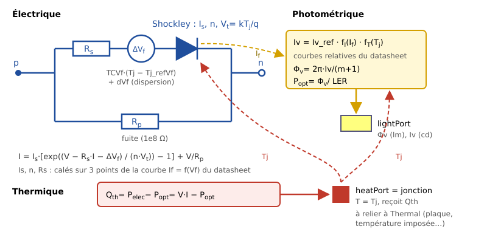

# LEDSystems

*[Version française](README.md) — English*

A [Modelica](https://modelica.org) library to simulate LEDs (light-emitting diodes),
single or in arrays, from their datasheet: voltage and current, luminous intensity and
luminous flux, dissipated power and junction temperature.

It is written for teaching (engineering sciences, French STI2D curriculum) and for sizing
simple lighting systems: choosing a current, a series or parallel layout, a heat sink;
checking the junction temperature.

## Features

- **Electrical model**: Shockley diode with series resistance and leakage resistance,
  fitted exactly to 3 points of the If = f(Vf) curve of the datasheet; forward voltage
  varies with temperature.
- **Photometric model**: intensity (cd) and flux (lm) as functions of current and
  junction temperature, from the relative curves of the datasheet; reference given in
  mcd or in lm.
- **Thermal model**: the dissipated heat (electrical power minus optical power) leaves
  through a thermal port that represents the junction, to be connected to a fixed
  temperature, a plate or any thermal network of the Modelica Standard Library.
- **Single LED, array of identical LEDs, matrix of individual LEDs** (manufacturing
  spread, ballast resistor, current sharing between strings).
- **Four real LEDs** ready to use, three of them validated against their datasheet:
  Vishay VLMW41S1T1, Bridgelux SMD 2835 0.2 W and 0.5 W, Lumileds LUXEON FX2-L Plus.

## Contents

| Package | Purpose |
|---|---|
| `UsersGuide` | User's guide: overview, tutorial, conventions, validation, release notes, license |
| `Examples` | Basic examples, then three use cases: solar spotlight, domestic lamp, automotive headlamp |
| `Components` | `LED`, `LEDArray`, `LEDMatrix`, `LEDWithPlate` |
| `Thermal` | Imposed temperatures (replay of measurements), heat-sink plate (prediction) |
| `Data` | Base record `LEDData` and one record per real LED |
| `Interfaces` | Photometric connector `LightPort` |
| `Functions` | Electrical model fitting, curve interpolation, manufacturing spread |
| `Types` | Enumerations |

The library documentation (class documentation, user's guide) and the parameter
descriptions are written in **French**; class and parameter names are in English.

## Installation

Requirements: [OpenModelica](https://openmodelica.org) (tested with version 1.26.1) and
the Modelica Standard Library 4.1.0, installed with OpenModelica. No other library.

1. Download the repository (*Code* button → *Download ZIP*, or `git clone
   https://github.com/gounelles/LEDSystems.git`).
2. In OMEdit, *File* menu, open a library: select the **folder** `LEDSystems` (the one
   that contains `package.mo`).
3. To load it at every start: *Tools* → *Options* → *Libraries*, add a user library and
   this time select the **file** `LEDSystems/package.mo`.

## Getting started

- Open `LEDSystems.UsersGuide` in OMEdit (*Documentation* tab): the guide is part of the
  library.
- Simulate the examples of `LEDSystems.Examples.Basics` in order: the documentation of
  each example says what to look at and gives the expected values.
- For another LED: the tutorial `UsersGuide.Tutorial` explains, step by step, how to write
  its record from the datasheet, and gives a prompt to have an AI draft a first version,
  to be checked afterwards.

## Validation

Each use-case LED is fitted on part of the points of its datasheet, then compared with
the **other** points (not used for fitting), with the measurement tolerances stated by
the manufacturer.

| LED | Fitting | Validation |
|---|---|---|
| Bridgelux DS55 (solar spotlight) | 15/15 | 29/29 |
| Bridgelux DS242 (domestic lamp) | 11/11 | 30/32 (2 deviations due to an inconsistency in the datasheet) |
| Lumileds DS394 (headlamp) | 15/15 | 33/33 |

The known limits of the model are detailed in `UsersGuide.Validation`. The verification
scripts (Python, standard library only) are in [`outils/`](outils/README.md) (French
for "tools"). The datasheets themselves are not provided (manufacturers' copyright): each
record cites the document and its revision.

## Versions

See `UsersGuide.ReleaseNotes`. The current version is given in the annotation of the file
`LEDSystems/package.mo`.

## License

- Code (Modelica files, Python scripts): BSD-3-Clause license, see [LICENSE](LICENSE).
- Documentation (documentation texts, user's guide, this README) and images in
  `LEDSystems/Resources/Images`: Creative Commons Attribution 4.0 International license,
  see [LICENSE-CC-BY-4.0.txt](LICENSE-CC-BY-4.0.txt).

© 2026 Stéphane Gounelle.

## Author and contact

Stéphane Gounelle — gounelles@gmail.com

To report a problem or suggest an LED: the
[Issues](https://github.com/gounelles/LEDSystems/issues) tab of the repository.

## Origin of the project

The library was first written by hand by the author (version 0.4.0, not functional). It
was then completed with the [Claude Code](https://claude.com/claude-code) assistant
(Anthropic): restructuring, redesign of the model, correction of the calculations, LED
arrays, validation against datasheets, documentation. Each step was presented, discussed
and approved by the author. The file [CLAUDE.md](CLAUDE.md) (in French) contains the
working rules, the decisions and the complete log of these steps.
