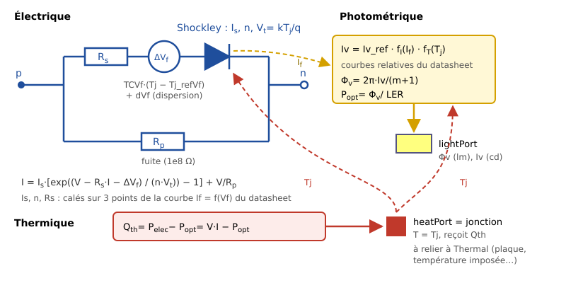

# LEDSystems

*Français — [English version](README.en.md)*

Bibliothèque [Modelica](https://modelica.org) pour simuler des LED (diodes
électroluminescentes), seules ou en réseaux, à partir de leur datasheet : tension et
courant, intensité et flux lumineux, puissance dissipée et température de jonction.

Elle est écrite pour l'enseignement (Sciences de l'ingénieur, STI2D) et pour le
dimensionnement de systèmes d'éclairage simples : choix d'un courant, d'un montage série
ou parallèle, d'un dissipateur ; vérification de la température de jonction.

## Fonctionnalités

- **Modèle électrique** : diode de Shockley avec résistance série et résistance de fuite,
  calée exactement sur 3 points de la courbe If = f(Vf) du datasheet ; variation de la
  tension directe avec la température.
- **Modèle photométrique** : intensité (cd) et flux (lm) en fonction du courant et de la
  température de jonction, par les courbes relatives du datasheet ; référence donnée en
  mcd ou en lm.
- **Modèle thermique** : la chaleur dissipée (puissance électrique moins puissance
  optique) sort par un port thermique qui représente la jonction, à relier à une
  température imposée, une plaque ou tout réseau thermique de la Modelica Standard
  Library.
- **LED seule, réseau de LED identiques, matrice de LED individuelles** (dispersion de
  fabrication, résistance de ballast, partage du courant entre branches).
- **Quatre LED réelles** prêtes à l'emploi, dont trois validées sur leur datasheet :
  Vishay VLMW41S1T1, Bridgelux SMD 2835 0,2 W et 0,5 W, Lumileds LUXEON FX2-L Plus.

## Contenu

| Package | Rôle |
|---|---|
| `UsersGuide` | Guide d'utilisation : vue d'ensemble, tutoriel, conventions, validation, notes de version, licence |
| `Examples` | Exemples de base, puis trois cas d'usage : spot solaire, lampe domestique, phare automobile |
| `Components` | `LED`, `LEDArray`, `LEDMatrix`, `LEDWithPlate` |
| `Thermal` | Températures imposées (rejeu de mesures), plaque dissipatrice (prédiction) |
| `Data` | Record de base `LEDData` et un record par LED réelle |
| `Interfaces` | Connecteur photométrique `LightPort` |
| `Functions` | Calage du modèle électrique, interpolation des courbes, dispersion |
| `Types` | Énumérations |

## Installation

Prérequis : [OpenModelica](https://openmodelica.org) (testé avec la version 1.26.1) et la
Modelica Standard Library 4.1.0, installée avec OpenModelica. Aucune autre bibliothèque.

1. Télécharger le dépôt (bouton *Code* → *Download ZIP*, ou `git clone
   https://github.com/gounelles/LEDSystems.git`).
2. Dans OMEdit, menu *Fichier*, ouvrir une bibliothèque : choisir le **dossier**
   `LEDSystems` (celui qui contient `package.mo`).
3. Pour la charger à chaque démarrage : *Outils* → *Options* → *Bibliothèques*, ajouter
   une bibliothèque utilisateur en indiquant cette fois le **fichier**
   `LEDSystems/package.mo`.

## Premiers pas

- Ouvrir `LEDSystems.UsersGuide` dans OMEdit (onglet *Documentation*) : le guide est
  intégré à la bibliothèque.
- Simuler les exemples de `LEDSystems.Examples.Basics` dans l'ordre : la documentation de
  chaque exemple dit quoi observer et donne les valeurs attendues.
- Pour une autre LED : le tutoriel `UsersGuide.Tutorial` explique, pas à pas, comment
  écrire son record à partir du datasheet, et propose un prompt pour en faire préparer
  un premier jet par une IA, à contrôler ensuite.

## Validation

Chaque LED des cas d'usage est calée sur une partie des points de son datasheet, puis
comparée aux **autres** points (qui n'ont pas servi au calage), avec les tolérances de
mesure annoncées par le fabricant.

| LED | Calage | Validation |
|---|---|---|
| Bridgelux DS55 (spot solaire) | 15/15 | 29/29 |
| Bridgelux DS242 (lampe domestique) | 11/11 | 30/32 (2 écarts dus à une incohérence du datasheet) |
| Lumileds DS394 (phare) | 15/15 | 33/33 |

Les limites connues du modèle sont détaillées dans `UsersGuide.Validation`. Les scripts
de vérification (Python, bibliothèque standard seulement) sont dans [`outils/`](outils/README.md).
Les datasheets eux-mêmes ne sont pas fournis (droits d'auteur des fabricants) : chaque
record cite le document et sa révision.

## Versions

Voir `UsersGuide.ReleaseNotes`. La version courante est indiquée dans l'annotation du
fichier `LEDSystems/package.mo`.

## Licence

- Code (fichiers Modelica, scripts Python) : Mozilla Public License 2.0 (MPL-2.0), voir
  [LICENSE](LICENSE).
- Documentation (textes de documentation, guide d'utilisation, ce README) et images de
  `LEDSystems/Resources/Images` : licence Creative Commons Attribution - Partage dans les
  Mêmes Conditions 4.0 International (CC BY-SA 4.0), voir
  [LICENSE-CC-BY-SA-4.0.txt](LICENSE-CC-BY-SA-4.0.txt).

En pratique : vous pouvez utiliser LEDSystems pour vos propres modèles, y compris dans un
cadre commercial, sous la licence de votre choix. Si vous **distribuez une version
modifiée des fichiers de la bibliothèque**, ces fichiers doivent rester sous MPL-2.0 et
leurs sources être fournies. Une adaptation de la documentation ou des images doit citer
l'auteur et rester sous CC BY-SA 4.0. Les versions 1.0.0 et antérieures restent
disponibles sous leurs licences d'origine (BSD-3-Clause et CC BY 4.0).

© 2026 Stéphane Gounelle.

## Auteur et contact

Stéphane Gounelle — gounelles@gmail.com

Pour signaler un problème ou proposer une LED : onglet
[Issues](https://github.com/gounelles/LEDSystems/issues) du dépôt.

## Origine du projet

La bibliothèque a d'abord été écrite à la main par l'auteur (version 0.4.0, non
fonctionnelle). Elle a ensuite été finalisée avec l'assistant
[Claude Code](https://claude.com/claude-code) (Anthropic) : restructuration, refonte du
modèle, correction des calculs, réseaux de LED, validation sur datasheets,
documentation. Chaque étape a été présentée, discutée et validée par l'auteur. Le fichier
[CLAUDE.md](CLAUDE.md) contient les règles de travail, les décisions et le journal
complet de ces étapes.
